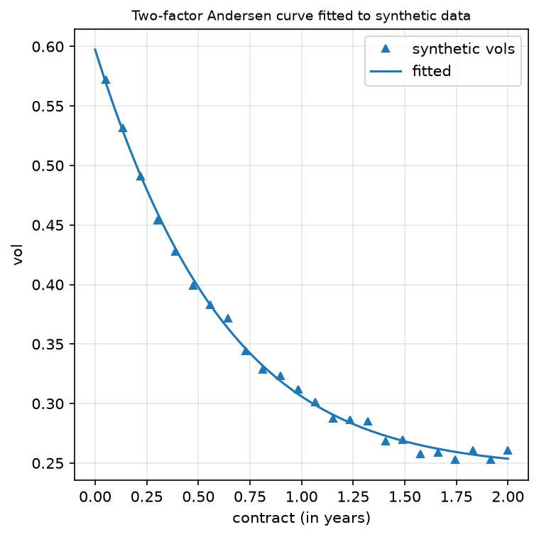

# Two-factor Andersen model for commodity vol surfaces

A showcase of a project that fits the two-factor Andersen model (Andersen, 2010) to commodity
implied and historical vol curves for potential-future-exposure risk-factor modelling.

This folder contains a short overview and a few demos that run on **synthetic data**. The full
implementation (market-data pipeline, calibration for WTI, Brent and Henry Hub, seasonality) is kept
in a private repository and is available on request.

## Contents

| Path | What |
|---|---|
| `Documentation/two_factor_andersen_model_page1.pdf` | First page of the model notes: model definition and parameter meaning |
| `Python/andersen_model.py` | Model vol curve and a simple least-squares fit |
| `Python/demo_synthetic_fit.py` | Fits the curve to synthetic data and writes `Documentation/demo_fit.png` |
| `Python/tests/test_andersen_model.py` | Offline tests of the curve limits and parameter recovery |

## Run

```bash
pip install -r requirements.txt
python Python/demo_synthetic_fit.py
python Python/tests/test_andersen_model.py
```



Reference: Andersen, L. (2010). Markov models for commodity futures: theory and practice.
Quantitative Finance, 10(8), 831-854.
